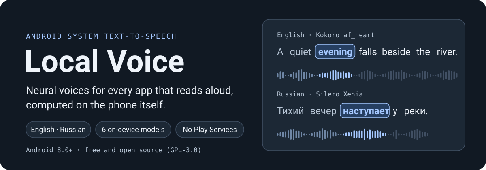
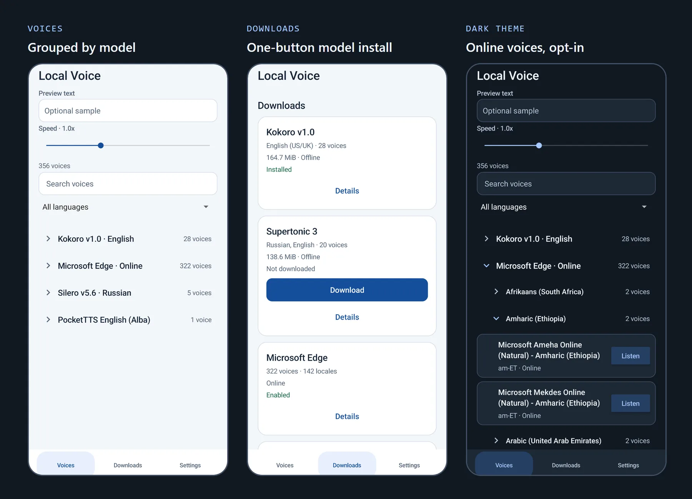

  

**Local Voice** gives your Android phone natural-sounding English and Russian voices that run on the phone itself. Set it as the system text-to-speech engine once, and the apps that read aloud through Android (Microsoft Edge Read Aloud, Chrome, e-book readers, Android's own settings) speak with it. Speech is produced offline; Microsoft's online voices are there only if you switch them on. No Google Play Services needed.

  

## What you get

- **Works in the apps you already use.** Local Voice plugs into Android's text-to-speech, so any app that reads aloud through it can use these voices.
- **Natural voices without the internet.** Six voice packs with dozens of English and Russian voices, generated on your phone.
- **One-tap downloads.** Pick a voice pack in **Downloads** and tap **Download**. Every file is checked before the voices appear, so an interrupted download never leaves a broken voice behind.
- **Follow-along highlighting.** Apps that highlight the word being read, such as Edge Read Aloud, can follow Local Voice as it speaks.
- **Preview and speed.** Listen to any voice before choosing it, and set a speaking speed that applies everywhere.
- **Clear licences.** Each voice pack shows its licence before you download it.

## Voices

| Voice pack | Language | Voices | Download | Licence |
| --- | --- | ---: | ---: | --- |
| Kokoro v1.0 | English (US/UK) | 28 | 164.7 MiB | Apache-2.0 (eSpeak data GPL-3.0) |
| Supertonic 3 | English, Russian | 10 × 2 | 138.6 MiB | OpenRAIL-M |
| PocketTTS English | English (UK) | 1 | 120.7 MiB | CC-BY-4.0 |
| Shtorm Russian | Russian | 1 | 419.7 MiB | CC-BY-4.0 |
| Silero v5.6 | Russian | 5 | 152.9 MiB | CC BY-NC-SA 4.0, **non-commercial** |
| NeuTTS Nano *(experimental)* | English (US/UK) | 6 | 484.2 MiB | NeuTTS Open License 1.0 |
| Microsoft Edge *(online, opt-in)* | 142 languages and regions | 322 | none | Microsoft service terms |

## Install and set up

You need Android 8.0 or newer on a 64-bit ARM phone, and free storage for the voice packs you want (120–485 MiB each).

1. Download `LocalVoice-<version>.apk` from the [latest release](https://github.com/SSS135/local-voice-tts/releases/latest) and install it. Android may ask you to allow installs from your browser or file manager.
2. Open **Local Voice** → **Downloads** → **Download** a voice pack. Keep the app open until it shows **Installed**.
3. **Voices** → tap a voice to choose it. **Listen** plays a sample without changing your choice.
4. Choose **Local Voice** as the preferred engine in Android **Settings** → **Text-to-speech output**. The app's **Settings** tab → **Android text-to-speech** opens that screen directly.

## Using it with apps

- **Microsoft Edge Read Aloud** reads pages with the voice you chose in Local Voice and highlights each word. After switching the engine, force-stop Edge (Settings → Apps → Edge → Force stop) and reopen it so Read Aloud picks up the change.
- **Chrome** uses Local Voice for websites that speak through the browser. Chrome does not pass word highlighting to web pages.
- **E-book and article readers:** choose the system or Android text-to-speech option in the reader's settings.
- **Word highlighting** is exact with Microsoft voices. With on-device voices the word timing is estimated, so the highlight can run slightly ahead of or behind the voice.
- **Microsoft online voices** are off until you tap **Enable** on the Microsoft Edge card in **Downloads**. Text is sent to Microsoft only when you pick an online voice and an app asks it to speak.

## Limits to know

- **Speed and heat.** Voices run on the phone's processor. Apart from NeuTTS Nano, speed, battery use and heat have not been measured on real phones. The first sentence after switching voices takes longer while the voice pack loads.
- **NeuTTS Nano is experimental and heavy.** On a Pixel 7 Pro it runs at about real-time speed, takes about 1.7 s before the first words, and warms the phone quickly.
- **Russian numbers.** Russian voices read numbers, dates, units and Latin words using built-in rules. The grammatical case is guessed from a neighbouring word, so some numbers can come out in the wrong form.
- **Downloads need the app open.** If Android closes the app mid-download, tap **Retry**; files that finished are kept.
- **No connection.** On-device voices work fully offline. An online voice waits and retries until the connection returns or the app stops speaking. Local Voice never swaps between online and on-device voices on its own.
- **Kokoro is English only.** For Russian, use Supertonic 3, Shtorm or Silero.

## Privacy

- On-device voices turn text into speech on your phone. That text is not sent anywhere.
- The app goes online to download voice packs (from Hugging Face and this project's GitHub releases) and, only if you enable them, for Microsoft online voices.
- Microsoft online voices use Microsoft's Read Aloud service, which is unofficial for this use and can change or stop working. Microsoft's terms apply to it.
- No ads, analytics or account.

## Licences

The app is free software under [GPL-3.0](LICENSE). Each voice pack has its own licence (see the table above). Silero is for non-commercial use only, and NeuTTS needs a paid Neuphonic licence above a revenue threshold. Full terms are under **Details** in **Downloads**, and the app's notices are under **Settings** → **About & licenses**.

**For developers:** see [docs/DEVELOPMENT.md](docs/DEVELOPMENT.md) and [AGENTS.md](AGENTS.md).
