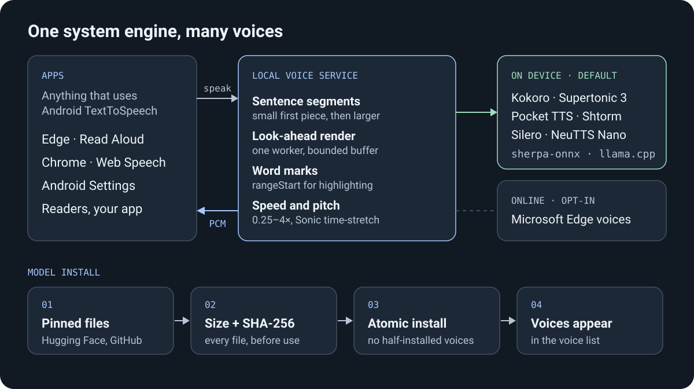

# Local Voice development

Build, signing, tests, packaging and provenance for `org.localvoice.tts`. Layout and contributor rules: [AGENTS.md](../AGENTS.md). Engine contract, cancellation and privacy boundary: [ARCHITECTURE.md](ARCHITECTURE.md). Historical release evidence: [history/](history/).

## Architecture in one picture

<p align="center">
  
</p>

The service cuts text into sentence segments, renders them ahead of playback on one worker and returns 16-bit PCM with `rangeStart` word marks (Microsoft `WordBoundary` timing for Edge; estimated per segment for local models). Each model family is an adapter behind one `SpeechBackend` contract, chosen from catalog metadata ([`models.json`](../app/src/main/resources/org/localvoice/tts/models.json)). Requested speed spans 0.25–4×; adapters render 0.5–2× natively and Sonic time-stretches the rest and applies pitch. Local inference is ARM64 CPU only (sherpa-onnx; NeuTTS via llama.cpp): no Google Play Services, NNAPI or GPU/NPU provider. Defaults: [performance baseline](ARCHITECTURE.md#performance-baseline).

## Build on Windows

Install a JDK 17 or newer, Android SDK Platform 36 and its build tools, NDK 29.0.14206865 and CMake 3.22.1 (the NeuTTS native library is compiled from pinned llama.cpp/eSpeak NG sources) using Android Studio/SDK Manager. Review and accept SDK licences yourself. The included build script does not install an SDK, accept licences or create an emulator.

Set `JAVA_HOME` and `ANDROID_HOME`, or pass paths explicitly. `fetch-runtime.ps1` fetches the sherpa-onnx 1.13.8 AAR into `app/libs/` and verifies its size and SHA-256:

```powershell
.\fetch-runtime.ps1
.\build.ps1 -JavaHome 'C:\path\to\jdk' -AndroidSdk 'C:\path\to\Android\Sdk' -CheckOnly
.\build.ps1 -JavaHome 'C:\path\to\jdk' -AndroidSdk 'C:\path\to\Android\Sdk'
```

The default tasks are `:app:assembleDebug` and `:probe:assembleDebug`. Outputs are `app/build/outputs/apk/debug/app-debug.apk` and `probe/build/outputs/apk/debug/probe-debug.apk`. The `probe` APK is a public-API test client, not needed by users. With the environment set, `.\gradlew.bat :app:assembleDebug` works directly; lint and other commands are in [AGENTS.md](../AGENTS.md).

`build.ps1` discovers Android Studio's JDK, a `javac` on PATH, and the usual per-user Android SDK when environment overrides are absent. A private `local.properties` file with a different `sdk.dir` must be updated or removed before using a new SDK path; it is excluded from the source package.

The Gradle wrapper selects **9.5.1**. Its first invocation downloads the pinned distribution from Gradle, checks `distributionSha256Sum`, and resolves Maven dependencies. An existing installation can be selected with `-GradleExecutable 'C:\path\to\gradle-9.5.1\bin\gradle.bat'`. Use `-GradleUserHome` to choose a cache and `-Offline` only after that cache is populated. This build path contains no task-specific VN Reader or SDK cache path.

```powershell
.\build.ps1 -Tasks ':app:assembleDebug', ':probe:assembleDebug'
.\build.ps1 -Tasks ':app:assembleRelease'
```

### Pinned dependencies

Pinned application dependencies are Android Gradle Plugin 9.2.0, Kotlin stdlib 2.3.21, OkHttp 5.4.0 and the supplied sherpa-onnx 1.13.8 AAR; tracing is constrained to 1.2.0. The root build script also selects Kotlin Gradle plugin 2.3.21 where AGP requests 2.2.10. sherpa AAR SHA-256: `633c24321e06b1fe79feafa03ea16cbc0f8a286641e2da3559bac91bdb13bd96`.

The copied standard wrapper bootstrap jar has SHA-256 `d3b261c2820e9e3d8d639ed084900f11f4a86050a8f83342ade7b6bc9b0d2bdd`, listed for Gradle's 8.6 bootstrap; it launches the pinned 9.5.1 distribution. The distribution SHA-256 is `bafc141b619ad6350fd975fc903156dd5c151998cc8b058e8c1044ab5f7b031f`. Both were checked against the [official Gradle checksum reference](https://gradle.org/release-checksums/). Wrapper scripts/jar retain Apache-2.0 terms in [GRADLE_WRAPPER_LICENSE.txt](../legal/GRADLE_WRAPPER_LICENSE.txt).

## Signing and updates

A clean source checkout builds debug with Android's normal debug key and release **unsigned**. To sign your own release, copy [signing.example.ps1](../signing.example.ps1) to a private `signing.local.ps1`, edit the external keystore path and dot-source it before the release build. The example prompts for the store password without echoing it. Gradle reads `LOCAL_VOICE_KEYSTORE`, `LOCAL_VOICE_STORE_PASSWORD`, optional `LOCAL_VOICE_KEY_ALIAS` (default `localvoice`) and optional `LOCAL_VOICE_KEY_PASSWORD` (defaults to the store password). An explicitly supplied missing keystore fails instead of silently signing with another key.

```powershell
. .\signing.local.ps1
.\build.ps1 -Tasks ':app:assembleRelease'
Remove-Item Env:LOCAL_VOICE_STORE_PASSWORD -ErrorAction SilentlyContinue
Remove-Item Env:LOCAL_VOICE_KEY_PASSWORD -ErrorAction SilentlyContinue
```

If you need a new independent signing identity, create the private destination directory yourself and run `keytool` interactively; passwords are prompted rather than put on the command line. Back up the resulting keystore/password separately. This new key cannot update an APK signed by the original delivered key.

```powershell
& "$env:JAVA_HOME\bin\keytool.exe" -genkeypair -keystore 'C:\private\LocalVoice\own-release.jks' -alias localvoice -keyalg RSA -keysize 3072 -validity 10000
```

The original delivered application's signing key is a **separate private backup**, not part of this source archive. Keep its keystore and password in durable private storage outside the source tree. Restoring that original key lets an owner sign compatible updates. Generating a new key or using the normal debug key cannot update an already installed APK signed by the original key; Android requires the matching signing identity. Do not replace or discard the original backup while testing a clean source build. The developer's existing private `signing/local-voice.keystore` path remains supported when its password environment variable is set, but that folder is excluded from shared source.

## Tests and verification

Run all host (JVM) checks; needs the AAR from `fetch-runtime.ps1` and `ANDROID_HOME` or `local.properties`:

```powershell
.\gradlew.bat test        # ./gradlew test on Linux/macOS
```

Checks are `main()` programs with a thin JUnit `check()` entry: `app/src/test/java` (Android unit tests, real `org.json` via `com.vaadin.external.google:android-json`) and `hosttest/` (actual `ModelStore` compiled against stub `android.*`/`Catalog`; its production file list is in `hosttest/build.gradle`). Each check class runs in its own JVM. `ShtormBpeCheck` is skipped unless the untracked `tools/models/shtorm/onnx` exists. Reports: `app/build/reports/tests/`, `hosttest/build/reports/tests/`.

The backend contract compiles actual production backend sources and uses injected fakes without loading native models. The Edge retry contract fault-injects transient/offline recovery, cancellation, real MP3/PCM staging limits and fatal errors against the production pure-Java helpers. The storage test uses assertions against actual disk helpers and catalog metadata. These suites do not prove Android API-26 runtime compatibility, JNI audio quality, real online recovery or framework callback behaviour.

Device and end-to-end drivers: [tests/e2e](../tests/e2e/README.md) (disposable emulator only). The [test-only WebSocket fixture](../tests/edge-fault-fixture/README.md) injects Edge transport/codec faults on an emulator.

Release evidence: [RELEASE-1.1.1.md](history/RELEASE-1.1.1.md), [VERIFICATION-PROFILE.md](history/VERIFICATION-PROFILE.md) (storage profiling methodology, raw evidence locations, runtime-measurement limits), [VERIFICATION-1.0-1.1.md](history/VERIFICATION-1.0-1.1.md) (1.0/1.1 acceptance tables, APK hashes and the 1.1.1 README's behaviour notes). Phone measurement: [NEUTTS-PHONE-BENCH.md](NEUTTS-PHONE-BENCH.md).

## Notes for client developers

- **Voice choice.** Clients that pick a voice by name get exactly that voice. Clients that only pass a locale get the voice selected in Local Voice whenever its language matches; the region only ranks the others.
- **Online voices** are discovered through `getVoices()` and marked network-required. Offline, disconnected or stalled Edge requests keep retrying the same chunk with bounded backoff until recovery or cancellation; they never skip text or fall back. Fatal invalid-voice/authorization/configuration errors still surface. Retry depends on the requesting app keeping the request open.
- **Legacy data check.** `ACTION_CHECK_TTS_DATA` checks installed local resources plus the selected online voice's locale. With zero local models and no selected online voice it returns `CHECK_VOICE_DATA_FAIL`, so a legacy client that gates on it may ask for a local-model install even though modern online discovery works.
- **Stopping.** Obsolete PCM is suppressed promptly, but native computation may finish its current bounded segment before unloading or switching models.
- **Sample rate differs per model** (24, 44.1 or 48 kHz); take it from the engine, do not hardcode it.
- **Word highlighting.** Edge Read Aloud highlights from `onRangeStart`; Chromium does not forward `onRangeStart` to Web Speech `boundary` events.
- **Unchanged VN Reader** automatic narration imposes a ten-minute timeout per prepared chunk; Local Voice cannot override that caller limit.

## Models

Catalog (sizes, SHA-256 pins, licences, attribution): [`models.json`](../app/src/main/resources/org/localvoice/tts/models.json). Conversion/export kits and runtime pins: [tools/models/README.md](../tools/models/README.md). Candidate models: [TTS-MODEL-SURVEY.md](TTS-MODEL-SURVEY.md).

- **Kokoro v1 English:** 28 US/UK voices, 24 kHz; pinned Hugging Face revision. Kokoro Russian is unsupported by the English adapter.
- **Supertonic 3:** ten styles, each in English and Russian, 44.1 kHz; pinned Hugging Face revision.
- **PocketTTS English** (`pocket-en-v2`): the project's INT8 ONNX export of Kyutai's `english_2026-09_2` checkpoint (release [`pocket-en-model-v2`](https://github.com/SSS135/local-voice-tts/releases/tag/pocket-en-model-v2); recipe [tools/models/pocket-en/REPRODUCE.md](../tools/models/pocket-en/REPRODUCE.md)) with one fixed Alba MacKenna voice (`en-GB`), 24 kHz. The previous `pocket-en-alba` install is deleted automatically on first start.
- **Shtorm Russian:** pinned fast FP32 ONNX conversion and one VCTK p228 reference voice, 24 kHz, fourteen files from the [`shtorm-model-v1`](https://github.com/SSS135/local-voice-tts/releases/tag/shtorm-model-v1) release. The release assets are byte-identical to the members of `LocalVoice-Shtorm-RU-fast-v1.zip`, exactly 440,049,147 bytes with SHA-256 `8b9892ae5f14539535d8d803a0161e4382ce1e590f4661efc7c180acc139ae88`; there is no ZIP import path. Frontend: [SHTORM-FRONTEND.md](SHTORM-FRONTEND.md).
- **Silero v5.6 Russian** (`silero-ru`): five voices, 48 kHz, Silero's stress/ё/homograph frontend ported to Java; six files from the [`silero-ru-model-v1`](https://github.com/SSS135/local-voice-tts/releases/tag/silero-ru-model-v1) release. Export and validation: [tools/models/silero-ru/REPRODUCE.md](../tools/models/silero-ru/REPRODUCE.md).
- **NeuTTS Nano English** (`neutts-nano-en`, experimental): six reference voices, 24 kHz, Q4_0 GGUF backbone on llama.cpp plus the int8 NeuCodec decoder, eSpeak NG phonemes; 22 files from the [`neutts-nano-model-v1`](https://github.com/SSS135/local-voice-tts/releases/tag/neutts-nano-model-v1) release. Recipe and deviations: [tools/models/neutts/REPRODUCE.md](../tools/models/neutts/REPRODUCE.md); phone benchmark: [NEUTTS-PHONE-BENCH.md](NEUTTS-PHONE-BENCH.md).
- **Microsoft Edge:** bundled metadata snapshot of 322 voices across 142 locales ([EDGE-CATALOG.md](EDGE-CATALOG.md)); explicit refresh replaces it only after complete validation.
- **Russian text** for Shtorm and Silero goes through the shared normalizer: [RUSSIAN-NORMALIZER.md](RUSSIAN-NORMALIZER.md).

## Source package and native source

Run from the repository root after final source/evidence review; `third_party\native-source\fetch-sources.ps1` first fetches the pinned native source ZIPs:

```powershell
.\package-source.ps1 -ListOnly
.\package-source.ps1 -OutputPath '.\dist\LocalVoice-source.zip'
```

The script uses [SOURCE-PACKAGE.json](../SOURCE-PACKAGE.json) as an allowlist, refuses existing output files, adds a SHA-256 member manifest and writes the ZIP's SHA-256 beside it. It stores every member under `LocalVoice/` and includes this project, `third_party/native-source`, `third_party/licenses` and the `tools/models` kits. It excludes `signing`, passwords, private local scripts, model weights, SDKs/AVDs, dependency caches, `.gradle`, build outputs and APKs. Read the emitted member list before distribution; a `.gitignore` alone is not the packaging boundary. Allowlist check without writing a ZIP: `.\tests\run-source-package-check.ps1`. Boundary details: [SOURCE-PACKAGING.md](SOURCE-PACKAGING.md).

The native source material includes pinned complete source snapshots, hashes and upstream build/workflow files for sherpa-onnx, piper-phonemize and eSpeak NG. See the [native source manifest](../third_party/native-source/source-manifest.json) and [build/source notes](../third_party/native-source/BUILD-AND-SOURCE-NOTES.txt). Native libraries were not independently rebuilt here. The upstream workflow's `ANDROID_NDK_LATEST_HOME` does not pin the exact published compiler/NDK environment; building the application against the supplied AAR is distinct from proving a byte-for-byte native rebuild. Preserve all required application/native source and licence materials with distribution.

## Licences and notices

- Application: GPL-3.0, [LICENSE](../LICENSE).
- Microsoft Edge protocol adaptation from VN Reader and its upstream LGPL component: [THIRD_PARTY_EDGE_NOTICES.txt](../legal/THIRD_PARTY_EDGE_NOTICES.txt), [EDGE_TTS_LICENSE.txt](../legal/EDGE_TTS_LICENSE.txt). VN Reader is not required or modified by this application.
- Sonic time-stretch adaptation: Apache-2.0 source/notices in [THIRD_PARTY_SONIC_NOTICES.txt](../legal/THIRD_PARTY_SONIC_NOTICES.txt) and `third_party/androidx-media3-sonic`.
- Upstream runtimes (eSpeak NG, piper-phonemize, sherpa-onnx, ONNX Runtime, llama.cpp, Supertonic): `third_party/licenses`.
- Models: Kokoro weights Apache-2.0 with its eSpeak frontend GPL-3.0; Supertonic 3 weights OpenRAIL-M; the Pocket/Shtorm packages CC-BY-4.0 with their conversion/reference-voice provenance; Silero v5.6 Russian CC BY-NC-SA 4.0 (non-commercial); NeuTTS Nano the NeuTTS Open License 1.0 (llama.cpp runtime MIT). The source archive includes no model weights. The in-app catalog discloses licences before download/use.

GPL/LGPL application-component source obligations and independent model/voice attribution remain applicable; see the included notices and [source packaging boundary](SOURCE-PACKAGING.md).

## Provenance

Imported from `LocalVoice-source-1.1.1.zip`, SHA-256
`b21d43e8ab334b1ed3ea4e51552afc99d6903eec493c8020b7ead575916be628`
(1.0.0: `f50b518a24fd0390b2e1c1474094fd6a989938ef695f07730fb3d2c740e85e73`).
Release verification: [history/](history/).
